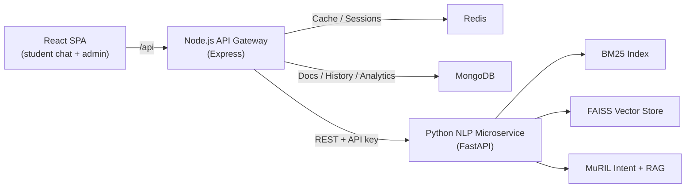

# CampusMate — Multilingual College Assistant

A citation-grounded campus assistant for higher-education institutions. Students ask questions in **English, Hindi, Gujarati, Hinglish, or Gujlish**; CampusMate retrieves official notices and circulars through hybrid neural search (BM25 + FAISS), verifies the answer against the source, and returns a grounded response with citations. An admin workspace covers document ingestion, analytics, feedback review, and cache operations.

The repository contains three runnable pieces:

| Piece | Stack | Dev port | Container port |
|---|---|---|---|
| React SPA (`client/`) | React 18, Vite, Tailwind, React Router, Framer Motion, Recharts | `5173` | `3000` (compose) / `80` |
| API gateway (`server/`) | Node.js, Express, MongoDB, Redis | `5005` via `run.sh`, `5000` via Docker | `5000` |
| NLP engine (`nlp-service/`) | FastAPI, MuRIL intent, BM25 + FAISS, RAG | `8080` via `run.sh`, `8000` via Docker | `8000` |

---

## Architecture



- **Frontend** (`client/`) — the student-facing landing/chat experience and the admin console (dashboard, documents, analytics, feedback, cache, settings). All data comes from the gateway; there is no mock data. Design and screen references live in [`client/DESIGN_SPEC.md`](client/DESIGN_SPEC.md), and the endpoint/auth contract is documented in [`client/src/services/API_CONTRACT.md`](client/src/services/API_CONTRACT.md).
- **Gateway** (`server/`) — authentication, rate limiting, conversation persistence, Redis caching, telemetry, and admin APIs.
- **NLP service** (`nlp-service/`) — language identification, transliteration, intent classification, hybrid retrieval, reranking, and grounded answer synthesis.

---

## Quickstart with Docker

```bash
cp .env.example .env          # fill in secrets if needed
docker compose up --build
```

Then open:

- Student app / admin console: **http://localhost:3000**
- API gateway health: **http://localhost:5000/health**
- NLP health: **http://localhost:8000/v1/health**

The browser calls `/api` on the same origin. The client container's nginx proxies `/api` to the gateway, so no CORS configuration is required for the SPA.

Seed the default admin and the initial superadmin (inside the running server container):

```bash
docker compose exec server node scripts/seedAdmin.js
docker compose exec server node scripts/seedSuperadmin.js
```

The superadmin credentials come from `SUPERADMIN_EMAIL` / `SUPERADMIN_PASSWORD` (defaults in `.env.example`); the admin fallback uses `ADMIN_DEFAULT_USER` / `ADMIN_DEFAULT_PASS` / `ADMIN_DEFAULT_EMAIL`. Change them in production.

Build the retrieval index once (writes to the mounted `data/index/`):

```bash
docker compose exec nlp-service python -m features.f01_hybrid_retrieval.build_index
```

Seed demo analytics for the dashboard:

```bash
docker compose exec server node scripts/seedAnalytics.js
```

This inserts 2,000 synthetic query logs. The UI can include or exclude seeded rows via the analytics filter, and `includeSeeded=only` isolates them. For a fully populated demo (documents, calendar, feedback, chat), run the richer root seeder after installing the server dependencies:

```bash
cd server && npm install && node ../scripts/seedAnalytics.js
```

---

## Local development

### 1. Backend + NLP

```bash
./run.sh
```

This starts MongoDB/Redis checks, the NLP service on `:8080`, and the gateway on `:5005`. The gateway reads `server/.env`, so copy the example first:

```bash
cp .env.example server/.env
```

Use the Docker setup instead if you prefer MongoDB/Redis in containers.

### 2. Frontend

```bash
cd client
cp .env.example .env.local
npm ci
npm run dev
```

Open **http://localhost:5173**. Vite proxies `/api` to the gateway. Because `run.sh` uses port `5005`, set the following in `client/.env.local`:

```dotenv
VITE_GATEWAY_URL=http://localhost:5005
```

If you use Docker for the backend (`:5000`), the default in `.env.example` is correct.

### Frontend scripts

| Command | Purpose |
|---|---|
| `npm run dev` | Vite dev server with HMR on `:5173` |
| `npm run build` | Production build into `client/dist` |
| `npm run preview` | Serve the production build locally |
| `npm run lint` | ESLint over `src/` |

### Frontend environment variables

| Variable | Default | Purpose |
|---|---|---|
| `VITE_API_BASE_URL` | `/api` | Gateway base path used by the fetch wrapper |
| `VITE_GATEWAY_URL` | `http://localhost:5000` | Vite dev proxy target for `/api` |
| `VITE_NLP_URL` | `http://localhost:8000` | Optional dev proxy target for `/nlp` |
| `VITE_API_TIMEOUT_MS` | `20000` | Fetch timeout |
| `VITE_STUDENT_PORTAL_URL` | empty | Optional Student Portal link; hidden when empty |
| `VITE_HELPDESK_EMAIL` | empty | Verified helpdesk email; hidden when empty |
| `VITE_HELPDESK_PHONE` | empty | Verified helpdesk phone; hidden when empty |
| `VITE_HELPDESK_HOURS` | empty | Verified helpdesk hours; hidden when empty |
| `VITE_CAMPUS_ADDRESS` | empty | Verified campus address; hidden when empty |
| `VITE_FEATURE_CALENDAR` | `true` | Show calendar navigation and routes |
| `VITE_FEATURE_CALENDAR_GOOGLE_OAUTH` | `false` | Enable Google Calendar OAuth |
| `VITE_FEATURE_SCENE_SNAP` | `false` | Landing-page scene snapshots |

Environment values are baked in at build time. For container builds, either edit `client/.env.production` or pass them as build arguments. Placeholder contact data is never shipped: empty values are hidden in the UI.

### Hero image

`client/public/images/campus-hero.jpg` is a stylized placeholder generated with `scripts/generate_hero.py`. Replace it with a real campus photo before launch:

1. Use a portrait/landscape image of at least **1200 × 1400 px** (JPG/WebP, ideally under 400 KB).
2. Overwrite `client/public/images/campus-hero.jpg` (or update the path in `client/src/pages/Landing.jsx`).
3. Rebuild with `npm run build`. The image is masked and receives a subtle parallax, so leave some breathing room around the subject.

Use imagery you have the rights to (institutional photography or a properly licensed stock photo).

---

## Core API

Full details, payload shapes, auth rules, and known gaps: [`client/src/services/API_CONTRACT.md`](client/src/services/API_CONTRACT.md).

```bash
# Chat (anonymous, optional X-Client-Id)
curl -X POST http://localhost:5005/api/chat \
  -H "Content-Type: application/json" \
  -d '{"query":"Exam form bharne ki last date kya hai for 5th sem?","sessionId":"demo-session"}'

# Admin login
curl -X POST http://localhost:5005/api/admin/login \
  -H "Content-Type: application/json" \
  -d '{"username":"admin","password":"Admin@123"}'

# Upload a notice (admin JWT)
curl -X POST http://localhost:5005/api/admin/documents/upload \
  -H "Authorization: Bearer <JWT>" \
  -F "file=@circular.pdf" \
  -F "title=End Semester Examination Schedule" \
  -F "topic_key=exam_schedule" \
  -F "doc_type=notice"
```

Admin routes require a Bearer access JWT (15 min, HS256) plus a rotating refresh cookie. The cache admin routes (`/api/admin/cache-stats`, `/api/admin/cache/invalidate`, `/api/admin/latency-stats`) are also protected now. Any admin `401` clears the local session and redirects the UI to `/admin/login`.

---

## Smoke tests

With the stack running:

```bash
./deploy/smoke_test.sh http://localhost:3000
```

The script runs **5 checks**: gateway health, an English chat query, a Hinglish chat query, a Hindi chat query, and a conversation history fetch.

Backend and frontend test/build commands:

```bash
cd server && npm test          # Jest (runInBand)
cd nlp-service && pytest       # FastAPI / NLP suites
cd client && npm run build     # Vite production build
```

### Regenerating generated assets

```bash
# Retrieval index (TF-IDF, BM25, FAISS) — writes data/index/
PYTHONPATH=nlp-service python3 -m features.f01_hybrid_retrieval.build_index
# or inside Docker:
docker compose exec nlp-service python -m features.f01_hybrid_retrieval.build_index

# Demo documents and analytics (labeled as demo/seeded)
cd server && node ../scripts/seedAnalytics.js
node scripts/seedAnalytics.js          # synthetic query-log seeder (2,000 rows)

# Evaluation results — writes eval/results/
python3 eval/eval_language_detection.py
python3 eval/run_intent.py
python3 eval/run_retrieval.py

# Hero placeholder image (replace with licensed artwork before launch)
python3 scripts/generate_hero.py
```

Large generated files (`*.joblib`, `*.faiss`, `data/index/`, `data/uploads/`, `client/dist/`, `node_modules/`, local `.env` files) are ignored and never committed.

---

## Production deployment

```bash
docker compose -f docker-compose.prod.yml up -d --build
```

In production, the outer nginx (`deploy/nginx/nginx.conf`) terminates TLS and routes:

- `/api/` → gateway
- `/nlp/` → NLP service
- `/assets/` → client container with a one-year immutable cache policy
- `/` → client container, which applies the SPA `try_files` history fallback

The client service has **no published host ports** in the production compose file; only nginx exposes `80`/`443`. Gzip is enabled for text assets and `gzip_static` is on for precompressed files. Brotli requires the `ngx_brotli` module in the nginx image and is not enabled by default; enable it there if your image includes it.

Put TLS certificates in `deploy/nginx/ssl/`. Set `CORS_ORIGIN` if the SPA is ever served from a different origin than the API (the default same-origin proxy setup does not need it).

---

## Project structure

```
├── client/                     # React 18 SPA (Vite)
│   ├── DESIGN_SPEC.md          # 8-screen design source of truth
│   ├── Dockerfile              # Multi-stage Vite build → nginx
│   ├── nginx.conf              # SPA fallback, API proxy, cache headers, gzip
│   └── src/
│       ├── components/         # UI kit, brand, shared primitives
│       ├── config/             # navigation, feature flags, landing copy
│       ├── context/            # auth and theme providers
│       ├── features/           # chat, calendar, auth, admin, documents
│       ├── layouts/            # public, chat, admin shells
│       ├── pages/              # landing, chat, admin screens, settings
│       └── services/           # API wrapper + API_CONTRACT.md
├── server/                     # Express gateway, auth, analytics, calendar
│   ├── features/               # f00–f18 feature modules and tests
│   ├── models/                 # shared Mongoose models
│   ├── routes/                 # chat routes
│   └── scripts/                # seedAdmin, seedSuperadmin, seedAnalytics, perf
├── nlp-service/                # FastAPI NLP microservice
│   ├── app/                    # pipeline, stages, API, schemas
│   ├── features/               # f01–f15 NLP feature modules and tests
│   └── tests/                  # API, stage and end-to-end tests
├── data/                       # datasets, lexicons, patterns, seed docs
├── eval/                       # evaluation scripts and real result JSON/MD
├── scripts/                    # documented demos, seeders, generators
├── deploy/                     # production nginx config and smoke test
├── docs/                       # feature documentation + CLEANUP.md
├── notebooks/                  # MuRIL training notebook
├── docker-compose.yml          # Local stack incl. client on :3000
├── docker-compose.prod.yml     # Production stack (nginx-only ingress)
└── run.sh                      # All-in-one local backend runner
```

---

## Accessibility and UX notes

- The interface is intentionally dark-only; the theme provider locks `data-theme="dark"` so no unsupported light theme is exposed.
- Every interactive control has a visible 2 px accent focus ring, and keyboard-only navigation is supported through dialogs, drawers, tabs, and the chat composer.
- Layouts are exercised at 360, 768, 1280, and 1920 px widths.
- Motion respects `prefers-reduced-motion`; the typewriter, tassel, and page transitions reduce to simple fades.
- Text on accent surfaces is white and meets WCAG AA contrast against the terracotta gradient.

Admin settings (profile name/email, interface language) are stored locally because the backend does not expose profile or preference endpoints yet. Logout clears the client-side JWT; the stateless token stays valid until expiry.
