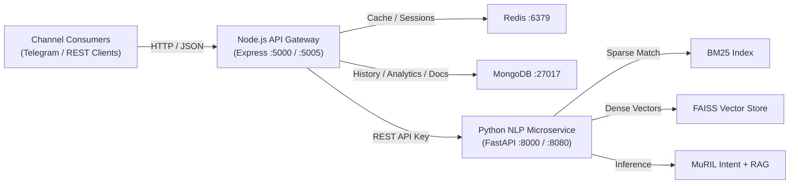

# CampusMate — Multilingual College Assistant (Backend & NLP Engine)

A production-grade, citation-grounded multilingual assistant backend for higher-education campuses. Understands English, Hindi, Gujarati, Hinglish, and Gujlish queries, retrieving official notices and circulars via hybrid neural search (BM25 + FAISS) with strict hallucination verification.

---

## 🏛️ Architecture Overview

The system operates as a decoupled microservice backend:



1. **Node.js Gateway (`server/`)**: Express API gateway managing authentication, rate limiting, dialogue session history, Redis caching, telemetry, and Telegram bot webhook/polling adapters.
2. **FastAPI NLP Engine (`nlp-service/`)**: High-throughput inference service executing language identification, phonetic transliteration (IndicTrans), transformer intent classification (MuRIL), hybrid retrieval (BM25 + FAISS + Cross-Encoder reranker), and RAG grounded synthesis.
3. **Data Stores**:
   - **MongoDB**: Primary document metadata, feedback annotations, latency logs, and conversation transcripts.
   - **Redis**: Low-latency query caching and active session state.

---

## 🚀 Quickstart: Run All Services

Start MongoDB, Redis, the NLP engine, and the API gateway with a single command:

```bash
./run.sh
```

*(or via npm: `npm start`)*

To run via Docker:
```bash
docker compose up --build
```

---

## 📡 Core API Usage Examples

### 1. Multilingual Chat Inquiry (`POST /api/chat`)

**Hinglish Query Example:**
```bash
curl -X POST http://localhost:5005/api/chat \
  -H "Content-Type: application/json" \
  -d '{
    "query": "Exam form bharne ki last date kya hai for 5th sem?",
    "sessionId": "session_student_01"
  }'
```

**Response:**
```json
{
  "answer": "The last date to submit the exam form for Semester 5 is November 25, 2024 without late penalty fees.",
  "language": "hi",
  "intent": "exam_deadline",
  "confidence": 0.96,
  "retrieved_chunks": [
    {
      "doc_name": "academic_regulations_2024.pdf",
      "page": 4,
      "score": 0.94
    }
  ],
  "latency_ms": 142,
  "cached": false
}
```

---

### 2. Admin Authentication (`POST /api/admin/login`)

First seed the default administrator account (if not already seeded):
```bash
node server/scripts/seedAdmin.js
```

Authenticate and obtain a JWT bearer token:
```bash
curl -X POST http://localhost:5005/api/admin/login \
  -H "Content-Type: application/json" \
  -d '{
    "username": "admin",
    "password": "AdminPassword123!"
  }'
```

---

### 3. Upload & Ingest Notice Document (`POST /api/admin/documents`)

Upload a PDF or scanned circular to be chunked and re-indexed into BM25 and FAISS:

```bash
curl -X POST http://localhost:5005/api/admin/documents \
  -H "Authorization: Bearer <YOUR_JWT_TOKEN>" \
  -F "file=@/path/to/circular.pdf" \
  -F "title=End Semester Examination Schedule 2024" \
  -F "topic_key=exam_schedule" \
  -F "doc_type=notice" \
  -F "department=Examination Cell" \
  -F "effective_date=2024-11-20"
```

---

### 4. Trigger Full Index Re-index (`POST /api/admin/reindex`)

```bash
curl -X POST http://localhost:5005/api/admin/reindex \
  -H "Authorization: Bearer <YOUR_JWT_TOKEN>"
```

---

### 5. Telegram Bot Integration (`/api/telegram`)

The bot operates automatically via polling in development or webhook in production:
```bash
# Check Telegram channel status
curl http://localhost:5005/api/telegram/status
```

---

## 🧪 Testing & Verification

Run automated test suites across all backend components:

```bash
# 1. Run Node.js Server Tests
cd server && npm test

# 2. Run Python NLP Engine Tests
cd nlp-service && pytest

# 3. Run Production Smoke Test Suite
./deploy/smoke_test.sh http://localhost:5005
```

---

## 📂 Project Structure

```
├── deploy/                     # Production deployment artifacts
│   ├── nginx/nginx.conf        # Reverse proxy config (SSL, rate limiting, routing)
│   └── smoke_test.sh           # 5-stage automated smoke test
├── docker-compose.yml          # Local container setup (Mongo, Redis, NLP, Gateway)
├── docker-compose.prod.yml     # Production container orchestration
├── docs/                       # Technical architecture & feature specifications
├── eval/                       # Accuracy benchmarks, test sets, and error analysis
├── nlp-service/                # Python FastAPI NLP Microservice
│   ├── app/                    # FastAPI core, routes, schemas, and pipeline
│   ├── features/               # NLP modules (retrieval, MuRIL intent, OCR, RAG)
│   ├── data/index/             # Pre-built BM25 and FAISS index artifacts
│   └── tests/                  # Pytest unit and integration test suites
├── run.sh                      # All-in-one background runner
├── server/                     # Node.js API Gateway & Telegram Bot
│   ├── features/               # Gateway modules (sessions, caching, analytics, admin)
│   ├── models/                 # Mongoose schemas (Document, Feedback, Analytics)
│   ├── routes/                 # REST endpoints
│   ├── scripts/                # Seeding and benchmark scripts
│   └── tests/                  # Jest test suites
```
