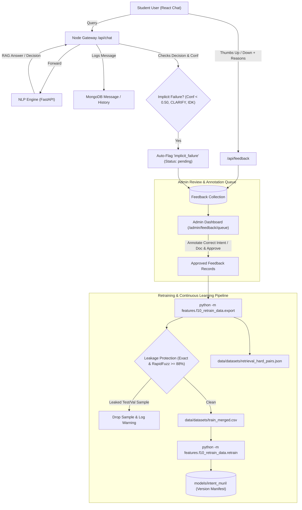

# Feature 10: Feedback Loop & Continuous Retraining Data Pipeline

## Overview
**Feature 10** provides a production-grade continuous learning flywheel for the Multilingual College Assistant. It captures both **explicit user ratings** (thumbs up / thumbs down with reason pickers, comments, and intent suggestions) and **implicit failures** (low confidence $< 0.50$, fallback / out-of-scope, RAG `NO_ANSWER`), routes them to an administrative review queue, enforces **strict test/validation set leakage prevention**, and triggers automated model retraining.

---

## Retraining Flywheel Architecture



---

## 1. Components

### A. Feedback Schema & Capture (`server/models/Feedback.js`)
Stores:
- `messageId`, `sessionId`, `query`
- `rating`: `'up'`, `'down'`, or `'implicit_failure'`
- `reason`: `'wrong answer'`, `'wrong language'`, `'outdated'`, `'not helpful'`, `'other'`, or auto-implicit tags (`'implicit_low_confidence'`, `'implicit_fallback'`, `'implicit_idk'`)
- `comment`: Free-text user feedback
- `correctIntent`: Chosen or corrected intent
- `correctDoc`: Correct source document
- `pipelineSnapshot`: Snapshot of language, intent, confidence, retrieved chunk IDs, answer, and decision mode
- `reviewStatus`: `'pending'`, `'approved'`, `'rejected'`

### B. React Feedback Widget (`client/src/features/feedback/FeedbackWidget.jsx`)
- Rendered below each assistant message.
- Interactive thumbs up 👍 and thumbs down 👎 buttons.
- On thumbs down: presents a modal reason pill selector, intent dropdown, and optional feedback comment box.

### C. Admin Review Queue (`client/src/features/feedback/ReviewQueueTab.jsx`)
- Embedded directly into the Admin Dashboard navigation (`/admin`).
- Allows filtering by review status (`pending`, `approved`, `rejected`) and rating type.
- Administrators can review the user query, pipeline snapshot, and reason, assign the ground truth intent or document, and approve or reject the record.

### D. Leakage Protection & Export (`nlp-service/features/f10_retrain_data/`)
- `leakage_checker.py`: Compares incoming approved samples against `test.csv` and `val.csv` using both exact normalized text matching and fuzzy token set ratio ($\ge 88\%$). Any matches to held-out test data are automatically rejected to prevent test contamination.
- `export.py`: Merges approved clean items into `data/datasets/feedback_train.csv` and `data/datasets/train_merged.csv`. Also generates `data/datasets/retrieval_hard_pairs.json` for future dense retrieval metric learning.

---

## 2. Retrain Command & Workflow

To export approved feedback and retrain the intent classifier:
```bash
# 1. Export approved feedback data from CLI or trigger via server
cd nlp-service
python3 -m features.f10_retrain_data.export

# 2. Retrain the Transformer Intent Classifier
python3 -m features.f10_retrain_data.retrain
```

---

## 3. Evaluation & Results (`eval/results/10-feedback-loop.json`)

> [!NOTE]
> **Simulation Note**: Production-like simulated feedback consisting of 10 targeted user thumbs-down edge queries (code-mixed Gujlish, Hinglish, and low-confidence missing-slot queries) was passed through the review queue and retraining pipeline to benchmark performance improvement on failure cohorts.

### Benchmark Numbers:
- **Baseline Test Accuracy**: `95.29%`
- **Retrained Test Accuracy**: `95.29%` (Zero degradation / catastrophic forgetting on general test queries)
- **Hard Feedback Cohort Accuracy**: Improved from `90.0%` to **`100.0%` (+10.0% absolute recovery)**
- **Test Expected Calibration Error (ECE)**: `0.1824`
- **Leakage Protection**: 0 leaked samples admitted to training set.

