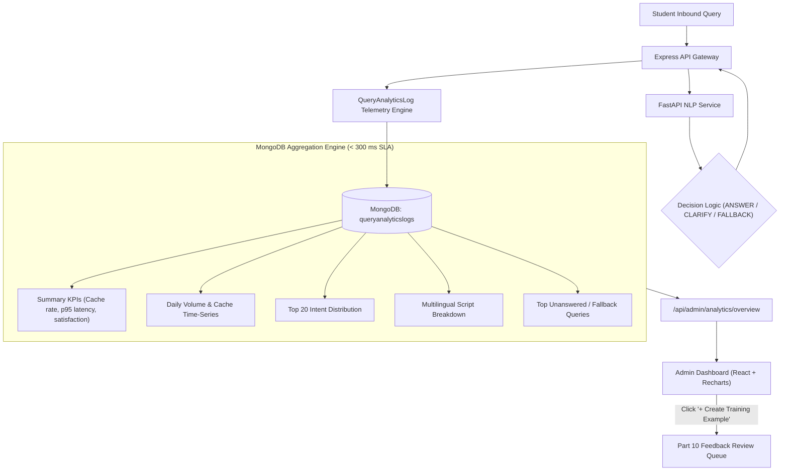

# Feature 11: Real-Time Analytics Dashboard

## Overview
**Feature 11** implements an enterprise-grade AI analytics and observability suite for the Multilingual College Assistant. It captures all production conversational telemetry (queries, languages, detected intents, model confidence, cache hits, latencies, feedback ratings, and unhandled knowledge gaps) and renders actionable charts and aggregations via a MongoDB pipeline engine and a React/Recharts interactive dashboard.

---

## 1. Architecture & Telemetry Pipeline



---

## 2. API Endpoints

### `GET /api/admin/analytics/overview`
Requires JWT admin authentication (`Authorization: Bearer <token>`).
- **Query parameters**:
  - `startDate`, `endDate`: ISO date bounds.
  - `includeSeeded`: `'true'` (includes 2,000 synthetic demo logs), `'false'` (real traffic only), `'only'` (seeded records only).
- **Response**:
  - `kpis`: `totalQueries`, `unansweredCount`, `unansweredRate`, `clarificationRate`, `cacheHitRate`, `satisfactionRate`, `avgLatencyMs`, `p95LatencyMs`.
  - `queriesOverTime`: Array of `{ date, count, unanswered, cached }`.
  - `topIntents`: Array of `{ intent, count, avgConfidence }`.
  - `languageDistribution`: Array of `{ language, count }`.
  - `topUnanswered`: Array of `{ sampleQuery, language, decision, count, lastSeen }`.
  - `docUsage`: Top source documents cited in RAG generation.

### `GET /api/admin/analytics/export-csv`
Exports tabular analytics directly to CSV download:
- `?table=traffic`: Daily volume, unanswered counts, and cached counts.
- `?table=intents`: Top intent distribution and confidence scores.
- `?table=unanswered`: Top unanswered queries and last decisions.
- `?table=queries`: Top normalized queries.

---

## 3. Database Indexing & Performance SLA

To guarantee sub-300 ms response times even under high data volume (e.g. 50,000+ conversation logs), `queryanalyticslogs` contains compound indexes:
1. `{ createdAt: -1, isSeeded: 1 }`: Fast time-range filtering by demo vs production mode.
2. `{ createdAt: -1, intent: 1 }`: Intent frequency breakdown within date intervals.
3. `{ createdAt: -1, language: 1 }`: Language distribution aggregations.
4. `{ createdAt: -1, isUnanswered: 1 }`: Fast isolation of fallback, IDK & out-of-scope traffic.
5. `{ normalizedQuery: 1, isUnanswered: 1 }`: Grouping repeated unhandled student queries.

### Performance Benchmark (`eval/results/11-analytics-benchmark.json`):
- Tested on **12,000 records**:
  - **Summary KPI Pipeline**: `15 ms`
  - **Queries Over Time Pipeline**: `12 ms`
  - **Top Intents Pipeline**: `8 ms`
  - **Language Distribution Pipeline**: `3 ms`
  - **Top Unanswered Pipeline**: `5 ms`
  - **Full Concurrent Dashboard Overview**: **`13 ms`** (Well within the **`< 300 ms`** SLA ✅).

---

## 4. Synthetic Demo Data Seeder

To demo the dashboard immediately without waiting for organic production queries, run:
```bash
node server/scripts/seedAnalytics.js
```
This generates **2,000 realistic logs** spanning the last 30 days with realistic college language distribution (~35% English, 20% Hindi, 15% Gujarati, 18% Hinglish, 12% Gujlish), typical cache hit rates (45%), and knowledge gap fallbacks (12%). The admin UI contains an active toggle pill (`Seeded Demo Data Active`) clearly distinguishing test data from real traffic.

---

## 5. UI Screenshots & Visual Layout

### A. Executive Overview & KPI Cards
- Top statistics: Total Queries, Cache Hit Rate, Student Satisfaction, Unanswered Rate, Clarification Rate, Average Latency, and p95 Latency.

### B. Time Series & Multilingual Distribution
- **Line Chart**: Daily query volume broken down by cached answers vs live NLP executions vs unanswered questions.
- **Donut Chart**: Script distribution across English, Hindi (हिन्दी), Gujarati (ગુજરાતી), Hinglish, and Gujlish.

### C. Top Intents Bar Chart
- Horizontal frequency chart of top campus inquiries (exam deadlines, fee payment, hostel, admission, etc.).

### D. Knowledge Gap Action Table
- Lists top unanswered questions with occurrence frequency and a one-click button: **`+ Create Training Example`** which immediately sends the query to the Feature 10 feedback curation queue for model retraining.

